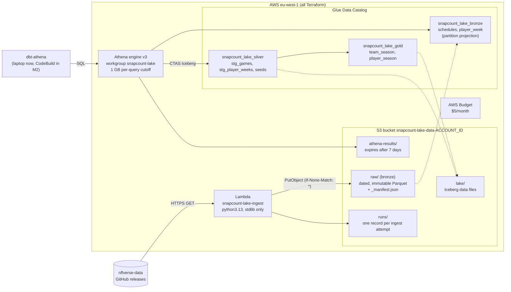

# snapcount-lakehouse

NFL seasons, from the raw [nflverse](https://github.com/nflverse/nflverse-data) release files to
tested gold tables on AWS. Ingest is a small Python Lambda; bronze is immutable Parquet in S3;
silver and gold are Iceberg tables built by dbt on Athena; everything is Terraform; the whole
stack goes up with `make up`, comes down with `make down`, and is meant to cost under $1 a month.

It is the data-engineering twin of [snapcount](https://github.com/Victor-Nyangi/snapcount), which
computes the same numbers in Postgres. Snapcount's numbers are the lake's parity tests.

**Status: Milestone 1 (the 2025 season) is built and tested locally. It has not yet been run on
AWS** (see [Runbook](#runbook)).

## Architecture



### Design choices

- **Bronze never changes.** Each download lands under
  `raw/<dataset>/[season=YYYY/]ingest_date=YYYY-MM-DD/` with a `_manifest.json` (url, sha256,
  bytes, fetched_at). S3 writes use `If-None-Match: *`, so an existing object can't be replaced
  even by a bug. An unchanged file (same sha256 as the latest manifest) writes nothing.
- **"I couldn't look" is not "the run failed".** A 404, 5xx or timeout from GitHub gives
  `source_unavailable`, writes nothing under `raw/`, and the run still exits ok. Only `failed`
  (not Parquet, or a write that would overwrite bronze) makes `ok` false. Every attempt leaves a
  record under `runs/`, outside the tables.
- **No crawler.** Bronze tables use Athena partition projection over the ingest key layout.
  Files starting with `_` (the manifests) are ignored by Athena.
- **Silver reads only the newest ingest** (per season for player stats), so re-ingesting never
  double-counts. Team codes LA, SD and OAK map to LAR, LAC and LV through a seed, so every team
  in silver and gold is one of snapcount's 32.
- **Guardrails are in code:** the Athena workgroup enforces its settings and cancels any query
  scanning over 1 GB; the data bucket is private and encrypted; old versions under `raw/` expire
  after 30 days and query results after 7; the ingest role can only get, put and list under
  `raw/` and `runs/`.

## Layout

```
ingest/lake_ingest/   fetch, store (S3 / local), handler (Lambda), __main__ (CLI)
ingest/tests/         pytest, no network
infra/bootstrap/      one-time Terraform state bucket (local state)
infra/lake/           the lake stack; tests/lake.tftest.hcl runs against a mocked provider
transform/            dbt project: seeds, silver, gold, schema tests, unit tests, parity tests
scripts/              parity_from_snapcount.py: snapcount's backfill dump -> parity seed
docs/cost.md          what it actually costs
```

## Runbook

Everything that creates, changes or destroys AWS resources is run by Victor with the
`snapcount-lake` SSO profile (`AWS_PROFILE` defaults to it in the Makefile). No long-lived keys
exist anywhere.

### Prerequisites

- AWS CLI v2, Terraform >= 1.10 (built with 1.17.2), [uv](https://docs.astral.sh/uv/).
- An AWS account (ideally its own, or an Organizations member) with IAM Identity Center.

### One-time setup

```bash
aws configure sso --profile snapcount-lake   # region eu-west-1
aws sso login --profile snapcount-lake
uv sync
make bootstrap                               # state bucket snapcount-lake-tfstate-<account_id>
cp infra/lake/terraform.tfvars.example infra/lake/terraform.tfvars   # gitignored; set budget_email
```

### Each run

| Step | Command | Expect |
|---|---|---|
| Stand up | `make up` | clean apply; outputs `data_bucket`, `athena_workgroup`, `glue_databases`, `ingest_function_name` |
| Ingest | `make ingest SEASON=2025` | `"ok": true`, `schedules` and `player_week` both `fetched` |
| Re-ingest | `make ingest SEASON=2025` | both `unchanged`, nothing new under `raw/` |
| Build | `make build` | `dbt seed` then `dbt build`: every model, generic, unit and parity test PASS; under 50 MB scanned in total |
| Re-test | `make test` | the same tests against the built tables |
| Tear down | `make down` | clean destroy; the state bucket stays |
| Rebuild | `make up && make ingest SEASON=2025 && make build` | everything green again |
| Cost | `make cost` | after 7 days, under $0.25; record it in `docs/cost.md` |

`make cost` filters on the `Project` tag, which only works once `Project` is activated as a
cost allocation tag (Billing console, or `aws ce update-cost-allocation-tags-status`), and tags
take up to 24 hours to show. The second table it prints is the whole account by service, which
is the honest number for a dedicated account.

### Local checks (no AWS)

```bash
make check          # ruff, pytest, terraform fmt/validate/test (mock provider), dbt parse, sqlfluff
make smoke          # real nflverse download into ./.lake-local (GitHub only, no AWS)
make parity-seed    # regenerate transform/seeds/parity_expected_2025.csv from snapcount's dump
```

CI (`.github/workflows/ci.yml`) runs `make check`'s steps and never touches AWS in Milestone 1.

## Parity with snapcount

`scripts/parity_from_snapcount.py` reads snapcount's Postgres backfill dump and writes
`transform/seeds/parity_expected_2025.csv`. Three dbt tests fail if gold disagrees:

| Test | 2025 expectation |
|---|---|
| `parity_game_counts` | 272 regular-season games, 13 postseason |
| `parity_player_season_count` | 2,019 player-seasons |
| `parity_team_records` | all 32 W-L-T records (e.g. DEN, NE, SEA 14-3-0; DAL 7-9-1; GB 9-7-1) |

Across 2016-2025 snapcount holds 2,761 games and 19,521 player-seasons; that is the Milestone 2
backfill target.

## Costs

Estimates until `make cost` has a week of real numbers; see [docs/cost.md](docs/cost.md).

| Service | What drives it | Expected per month |
|---|---|---|
| S3 | ~1.4 MB per ingest, plus Iceberg files | < $0.01 |
| Athena | $5/TB scanned, 10 MB minimum per query; a full `dbt build` is roughly 50-80 queries | < $0.05 |
| Lambda | a few invocations, well inside the free tier | $0.00 |
| Glue Data Catalog | a handful of tables, inside the free tier | $0.00 |
| CloudWatch Logs | 14-day retention, tiny | < $0.01 |
| AWS Budgets | first two budgets are free | $0.00 |

## Pinned versions

| Tool | Version |
|---|---|
| Python | 3.13 (Lambda runtime `python3.13`, arm64) |
| Terraform | 1.17.2 (`required_version >= 1.10`) |
| hashicorp/aws provider | `~> 6.73` (locked 6.73.0) |
| hashicorp/archive provider | `~> 2.8` (locked 2.8.1) |
| dbt-core | 1.12.7 |
| dbt-athena-community | 1.11.2 |
| sqlfluff | 4.5.0 |

Python versions are locked in `uv.lock`; provider versions in `infra/*/.terraform.lock.hcl`.

## Data source and licence

Data comes from [nflverse-data](https://github.com/nflverse/nflverse-data) release files, published
under [CC-BY 4.0](https://github.com/nflverse/nflverse-data/blob/master/LICENSE.md). Credit to the
nflverse project and its contributors. The data is not redistributed here; the lake downloads it.

This repository's code is [MIT](LICENSE) licensed.
